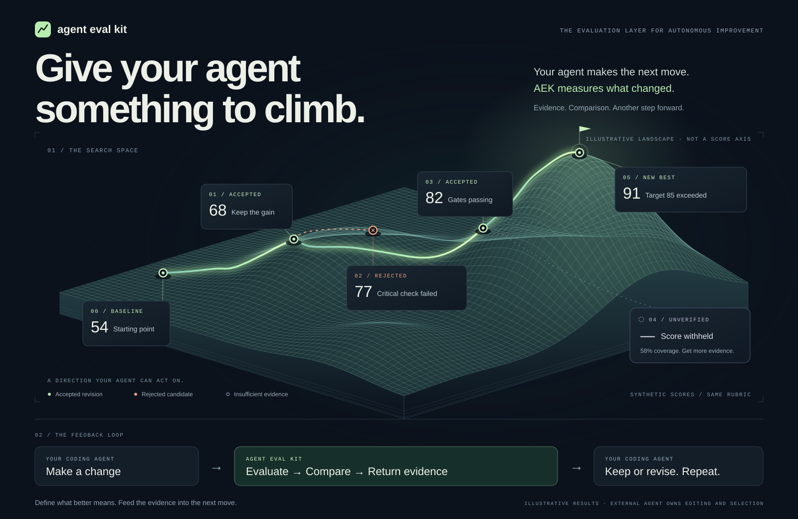

# Agent Eval Kit (`aek`)

**Give your agent something to climb.** Define what better means, evaluate each
revision, and feed the evidence into your agent's next move. AEK supplies the
evaluation and comparison layer for an autonomous improvement loop; your coding
agent or orchestration makes changes and selects candidates.

[](docs/marketing/index.html)

[Open the interactive visual locally](docs/marketing/README.md) ·
[Download the graphic](docs/marketing/hill-climbing.png) ·
[Build the silent social video and run its evals](video/marketing/README.md)

`aek` is a configurable, evidence-first evaluation harness for any software project. It runs test scenarios with the coding-agent subscription you already pay for—OpenAI Codex, Claude Code, Grok Build, or Cursor—then uses a fresh agent context plus deterministic checks to score a weighted rubric.

No provider SDK and no API key are required.

This is an early pre-release project. Backward compatibility is not a requirement: configuration, artifact formats, and APIs may change without migration support. Regenerate affected runs and baselines after such changes.

## What it evaluates

- Deployed or locally managed web apps, repositories, and command-line projects.
- Browser scenarios and read-only repository inspection, scored by deterministic
  command checks, independent LLM judges, manual or weighted hybrid review, and
  critical pass/fail gates.
- Controlled visual capture, blind image comparisons, and direct text comparison
  and rubric grading.
- Resumable, integrity-checked runs with reproducibility receipts, separate
  collect-then-judge bundles, offline rescore, and auditable manual finalization.
- Case matrices, development/evaluation splits, repeated-run campaigns, and
  compatibility-checked comparisons against promoted baselines.
- Interchangeable agent and judge providers, plus minimal public exports with a
  privacy lint.
- Coding-agent skills for guided suite authoring and
  [bounded project improvement](docs/improvement.md).

See the [full capability list](docs/capabilities.md) and
[evaluation types and boundaries](docs/evaluation-types.md).

## Why this design

The score and the evidence coverage are separate. `cannot_judge` never becomes a zero, and a negative verdict is discarded when every scenario behind it was blocked before it could look. A high score over thin evidence is withheld below the configured coverage threshold.

The evaluator and judge are also separate runs. The judge sees collected evidence, not the scenario agent's private reasoning, which reduces self-confirmation bias.

Explicitly source-level criteria may be judged from inspected code and concrete static counterexamples. Runtime, integration, and persistence criteria still require evidence that the behavior was exercised; source inspection alone cannot establish those claims.

```text
evalkit.yaml + specs + fixtures
               │
               ├── scenario agent (Codex / Claude / Grok / Cursor subscription)
               │      ├── browser MCP evidence, or read-only workspace inspection
               │      └── screenshots, observations, transcript, provider events
               │
               ├── deterministic command graders
               └── fresh structured-output judge
                         │
                         └── report.json + report.html + manual checklist
```

See the [evidence and safety model](docs/deployment.md#evidence-and-safety-model)
for the boundaries AEK enforces.

## Requirements

- Linux is the validated runtime. Native Windows evaluation is unsupported and fails before launch. On Windows, run inside WSL using Linux Node.js, provider CLIs, and browser dependencies—not Windows executables through WSL interop. macOS is not yet CI-certified.
- Node.js 20.19+
- pnpm for source development, or npm/pnpm to consume the built package
- at least one supported CLI, already signed into a subscription, for real agent collection or model judging; the offline walkthrough needs none
- Playwright Chromium for browser scenarios (`pnpm exec playwright install chromium`); text, workspace, and command-only evaluations do not need it

```bash
# Codex: choose “Sign in with ChatGPT”
codex

# Claude Code: use a Pro, Max, Team, or Enterprise account
claude

# Grok Build: browser login; device auth is also available
grok login
```

Verify the machine without spending model quota:

```bash
aek doctor
```

When `evalkit.yaml` is present, `doctor` requires only its configured providers
and requires Chromium only if a browser scenario is defined. Outside a configured
project it probes all providers, succeeds when at least one is ready, and reports
Chromium as optional. Use `--config file` or `--providers codex,claude` to check an
explicit setup. See [provider behavior](docs/providers.md) for adapter contracts
and Cursor setup.

## Install

### Built package distribution

`pnpm package:release` builds a versioned production tarball and SHA-256 checksum
under `.agent-eval/release/`. Consumers can install the tarball directly in their
project's root:

```sh
npm install --save-dev /path/to/agent-eval-kit-0.7.0.tgz
npx aek --help
```

For browser scenarios, install the matching browser from the consuming project:

```sh
npx --no-install playwright install chromium
```

No repository clone, TypeScript build, or development dependencies are needed in
the consuming project. The package includes first-run, text-datasets, and authoring
examples plus the authoring and improvement skills. Provider CLIs and browser dependencies still
apply to the selected evaluation mode. For a published GitHub release, download its `.tgz` and
matching `.sha256`, verify with `sha256sum -c`, then install the tarball.
See [release packaging](docs/development.md#release-packaging) for how releases are built.

Use `npx aek` for a local npm installation, `pnpm exec aek` for a local pnpm
installation, or `aek` for a globally linked installation wherever the guides show
`aek`.

### From a source checkout

```bash
pnpm install
pnpm install:browser
pnpm build
pnpm link --global
```

Commands beginning with `pnpm aek` assume you are working from this source
checkout. See [development](docs/development.md) for checks and smoke tests.

## Quick start

1. **Run the offline demonstration.** From the project where AEK is installed:

   ```sh
   node node_modules/agent-eval-kit/examples/authoring/run.mjs ./aek-demo
   ```

   It retains working, deliberately broken, and restored runs plus their comparison,
   without provider access. Use [your first evaluation](docs/first-run.md) to run the
   steps yourself and learn to read score, coverage, and critical gates.

2. **Start an evaluation for your project.** In your project's root:

   ```sh
   npx aek init --kind command
   ```

   Choose `--kind web` (the default), `repository`, `command`, `artifact`, or `visual`.
   Initialization writes an editable starter, not a discovered evaluation of your project.
   Follow the generated `evals/ONBOARDING.md` to define one measurable requirement,
   prepare test state, and calibrate it on known-good and deliberately broken behavior;
   implement the checker before running the command starter (`aek check` runs it
   without creating a run). Edit `evalkit.yaml`, `evals/specs/core.yaml`, and
   `evals/fixtures.yaml`, then:

   ```bash
   aek validate
   aek list
   aek run --dry-run
   aek run
   aek runs list
   aek compare --baseline previous --candidate latest
   ```

   Artifacts go to `.agent-eval/runs/<timestamp>/`, which `init` adds to `.gitignore`.
   Each run lists every criterion's verdict in the terminal and prints its next
   commands. Open `report.html` for the evidence-backed report and keep `report.json`
   as the stable machine-readable result.
   See [onboarding your project](docs/onboarding.md) and
   [running evaluations](docs/runs.md).

3. **Let your coding agent author the suite.** Install the authoring and
   improvement skills into your project's agent skill directory:

   ```sh
   npx aek skills install            # add --agent claude for .claude/skills
   ```

   Then ask your coding agent: “Use $aek-author to survey this whole project, ask me
   about missing product expectations, and build an evaluation suite.” `aek author status`
   reports progress from the persistent `.aek-authoring/plan.json` map, separately
   from evaluation scores and rubric evidence coverage. See [project authoring](docs/authoring.md).

## Documentation

The [documentation index](docs/README.md) covers every workflow and reference:
[configuration](docs/configuration.md), [specs and cases](docs/specs.md),
[grader types](docs/graders.md), [text](docs/text-evaluation.md) and
[visual](docs/visual-evaluation.md) evaluation, [comparisons and campaigns](docs/comparisons.md),
[bounded project improvement](docs/improvement.md), [CLI automation](docs/cli.md#structured-results),
and [troubleshooting](docs/troubleshooting.md).
